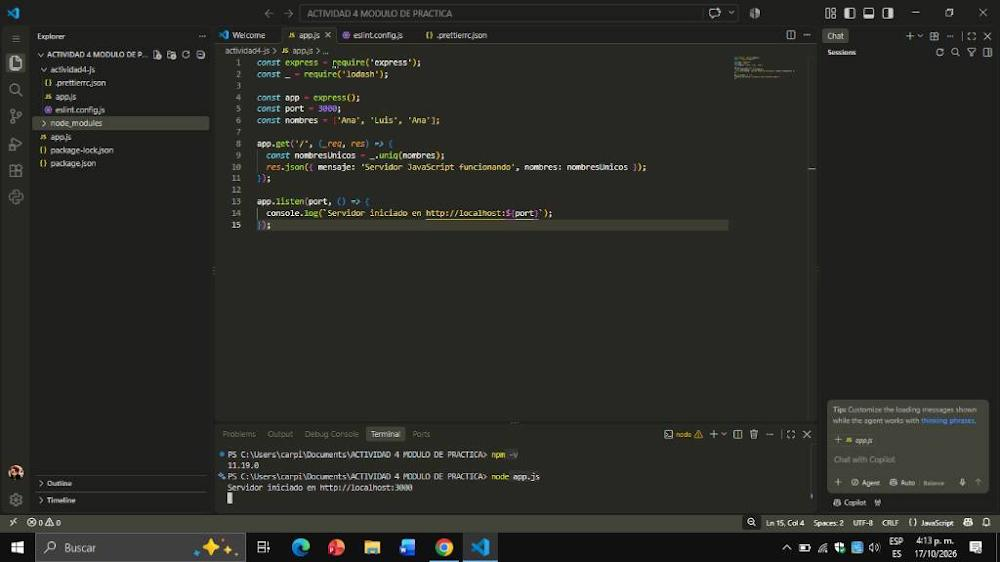
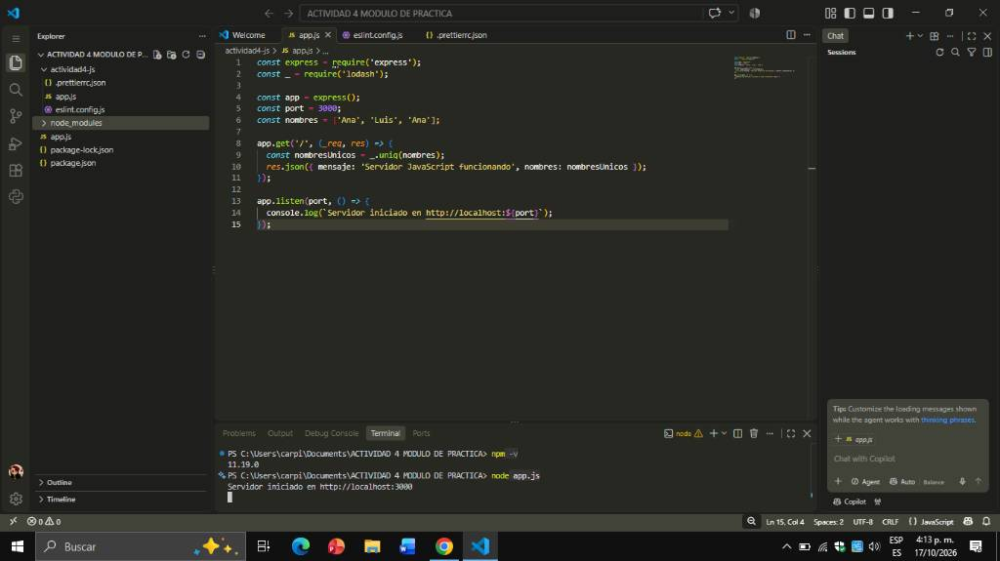
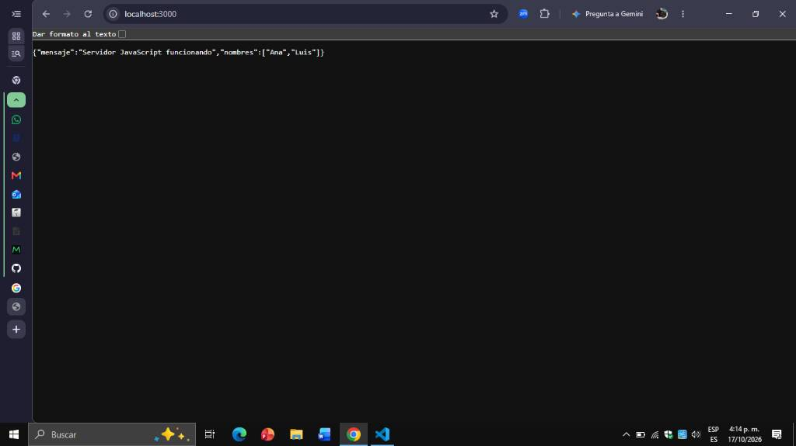
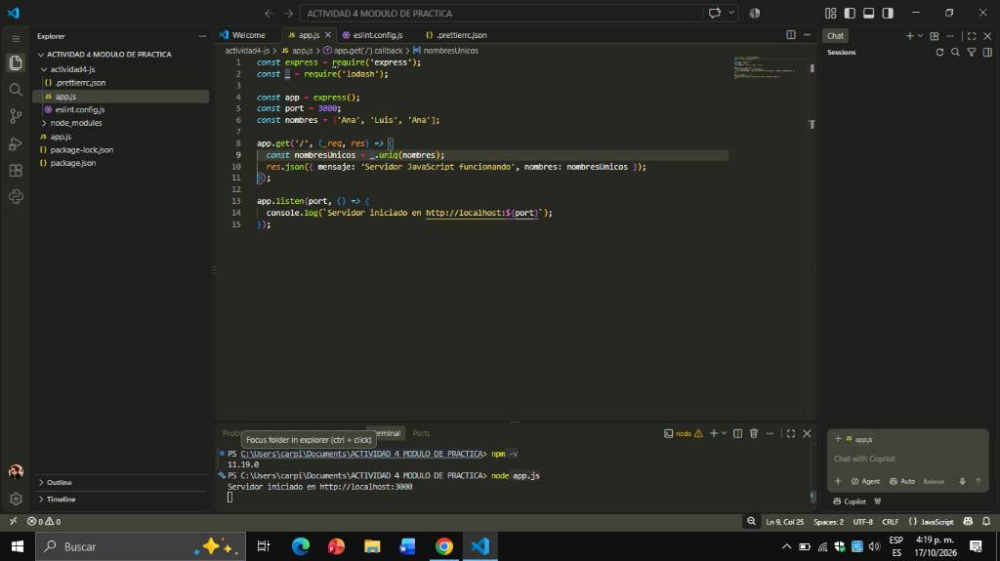

# Reporte de Instalación y Configuración del Entorno de Desarrollo (JavaScript)

## 1. Introducción
El objetivo de esta práctica es configurar un entorno de desarrollo profesional para JavaScript utilizando Node.js como entorno de ejecución, npm como gestor de paquetes y Visual Studio Code como IDE.

## 2. Pasos Detallados y Comandos
1. **Verificación de Herramientas**: Se abrió la terminal en Windows y se comprobaron las versiones instaladas con los comandos `node -v` y `npm -v`.

2. **Inicialización**: Se creó la estructura del proyecto y se generó el archivo `package.json` mediante `npm init -y`.

3. **Instalación de Dependencias**: Se instalaron los paquetes `express` (para el servidor) y `lodash` (para utilidades de código) usando `npm install express lodash`.

4. **Calidad de Código**: Se configuró Prettier para el formateo automático activando la casilla `Editor: Format On Save` en VS Code, vinculándolo con el archivo `.prettierrc.json`.

## 3. Problemas y Soluciones
* **Problema**: El formateador automático de Prettier no funcionaba al guardar el archivo con `Ctrl + S`, dejando espacios incorrectos en el código.
* **Solución**: Se ingresó a la configuración de VS Code (`Ctrl + ,`), se buscó la propiedad `Format On Save` y se activó la casilla correspondiente. Tras esto, el entorno limpia el código de forma automática.
